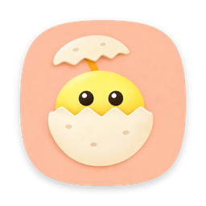
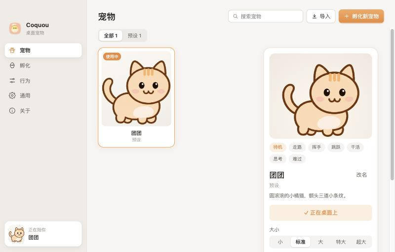
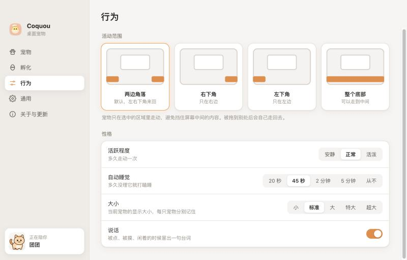
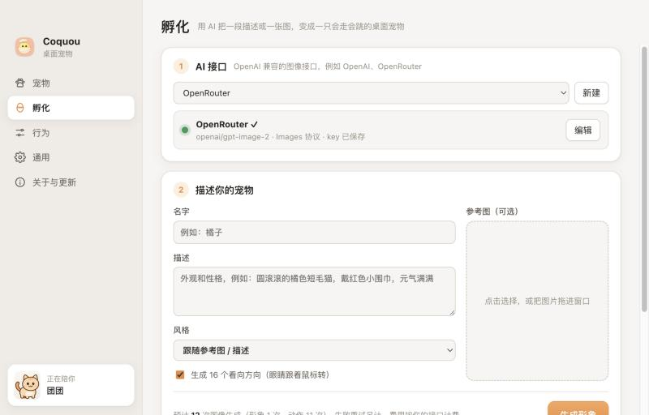

  

<h1 align="center">Coquou</h1>

一只住在你桌面角落里的小宠物。可以摸、可以拎、会说话， 兼容 Codex 宠物包，还能用 AI 孵化你自己的宠物。

  <a href="https://github.com/coquou/coquou/releases/latest">下载</a> ·
  <a href="#常见问题">常见问题</a> ·
  <a href="https://github.com/coquou/coquou/issues">反馈问题</a>

## 它能做什么

- **在桌面角落溜达**：默认只在屏幕左下角和右下角活动，不挡住屏幕中间的输入框和内容；鼠标经过宠物以外的地方，点击会直接穿透到下面的窗口。
- **可以互动**：单击会开心地跳一下，按住能拎起来甩出去，用鼠标在TA身上来回蹭就是撸TA，鼠标靠近时眼睛会跟着转，太久没理TA会打瞌睡。
- **会说话**：被点、被摸、被吵醒、闲着的时候冒出一句台词；不想听可以在「行为」里关掉。
- **自带一只原创宠物**：圆滚滚的小橘猫「团团」，也是用 Coquou 的 AI 孵化做出来的。
- **兼容 Codex 宠物包**：`~/.codex/pets` 里的宠物会自动出现在宠物库里；`.pet` 宠物包拖到宠物身上或主窗口里就能安装，也可以导出分享给朋友。
- **AI 孵化**：写一段描述，或者给一张参考图，用你自己的图像接口（OpenAI 或兼容服务）生成一整套会动的宠物。
- **不打扰**：全屏看视频、玩游戏、演示时自动隐藏；笔记本用电池时自动降帧省电；窗口不抢焦点，点宠物不会打断你正在打字的地方。
- **自动更新**：有新版本时提示你，点一下就更新。

## 下载安装

到 [Releases](https://github.com/coquou/coquou/releases/latest) 下载对应系统的安装包：

| 系统 | 文件 | 第一次打开 |
|---|---|---|
| macOS 11 及以上 | `Coquou_<版本>_macos-*.dmg` | 拖进「应用程序」。第一次打开时如果提示无法验证开发者：在「应用程序」里右键 Coquou →「打开」→「打开」 |
| Windows 10 / 11 | `Coquou_<版本>_windows-x86_64-setup.exe` | 运行安装包。如果出现「Windows 已保护你的电脑」：点「更多信息」→「仍要运行」 |

打开后宠物会从屏幕上方掉下来。Coquou 没有 Dock / 任务栏图标，它住在：

- **macOS**：屏幕右上角菜单栏里的小鸡图标；
- **Windows**：屏幕右下角的通知区域（可能收在「^」里）。单击打开主窗口，右键是菜单。

## 怎么玩

| 操作 | 反应 |
|---|---|
| 单击宠物 | 开心地跳一下、冒爱心；睡着时会被吓醒 |
| 按住拖动 | 拎起来，松手时会带着速度飞出去，落地会弹一下 |
| 把宠物拖到另一块屏幕再松手 | TA就搬到那块屏幕上 |
| 鼠标在TA身上来回蹭 | 被撸得脸红、冒爱心 |
| 鼠标靠近 | 眼睛跟着鼠标转 |
| 一段时间没理TA | 打瞌睡（Zzz） |
| 托盘菜单 / 右键宠物 | 打开 Coquou、叫TA回来、哄TA睡觉、退出（右键宠物弹出同一个菜单，但没有「退出」） |

## 主窗口

| 页 | 内容 |
|---|---|
| 宠物 | 宠物库：搜索、按来源筛选、悬停预览动画；选中一只可以预览各个动作、让TA上桌面、调大小、改名、改台词、导出、隐藏，自己安装的还能删除 |
| 孵化 | 用 AI 孵化新宠物 |
| 行为 | 活动范围、活跃程度、自动睡觉、大小、说话 |
| 通用 | 显示器、全屏时自动隐藏、开机自动启动、用电池时省电、宠物文件夹 |
| 关于与更新 | 版本、检查更新、更新说明 |

## 宠物包

Coquou 的宠物包就是 [Codex](https://openai.com/codex/) 的宠物包，再加一个可选的 `coquou.json`（台词、高清图集、额外动作）。所以：

- Codex 宠物可以直接拿来用，不用转换；
- Coquou 的宠物（包括预设的团团）导出后也能放进 Codex 用。

每只宠物都可以改名、改台词、隐藏，预设和 Codex 的宠物也一样。这些改动只记在 Coquou 的设置里，不动宠物文件，所以重新安装或更新宠物也不会丢；导出的 `.pet` 里是宠物原来的名字和台词。

分享用的单文件 `.pet` 其实就是 zip。安装方式：拖到桌面上的宠物身上、拖进主窗口、双击 `.pet` 文件，或者在「宠物」页点「导入」。格式细节见 [doc/pet-format.md](doc/pet-format.md)，想自己做宠物可以从这里开始。

## AI 孵化

1. 填一个图像接口：OpenAI 官方，或者 OpenRouter 这类兼容服务都可以，支持 Images 和 Chat 两种协议。
2. 写下宠物的外观和性格，选一种画风；有参考图的话直接拖进窗口。
3. 先生成形象，满意了再一键生成全部动作，最后安装到桌面。

一只宠物大约需要 12 次图像生成，费用按你的接口计费。中途关掉窗口也没关系，下次打开可以接着做，已经生成的图不会再收费。

## 隐私

- **没有账号、没有统计、没有任何上报。**
- AI 接口的 key 只存在本机系统的钥匙串（macOS）或凭据管理器（Windows）里，请求直接发到你填的接口地址。
- 联网只有两种情况：AI 孵化时访问你填的接口；检查更新时访问 GitHub（可以在「关于与更新」里关掉自动检查）。

## 常见问题

**宠物挡住了我要点的东西？**
宠物以外的地方点击都会穿透。如果宠物本身挡住了，可以把TA拖开，或者在「行为」里把活动范围改成只在一边的角落。

**全屏的时候宠物还在？**
在「通用」里确认开着「全屏时自动隐藏」。部分「无边框窗口化」的游戏系统不认为是全屏，这种情况可以从托盘「哄TA睡觉」，或者暂时退出 Coquou。

**macOS 每次用 AI 孵化都要输入密码？**
授权弹框里选「始终允许」即可。

**怎么彻底删除？**
删掉应用本身，再删掉数据文件夹：macOS 是 `~/Library/Application Support/io.github.coquou`，Windows 是 `%APPDATA%\io.github.coquou`。

**以前用的 Perchy？**
Coquou 就是 Perchy 改名后的版本。第一次启动会自动把旧的宠物、设置和 AI 配置搬过来。

## 参与开发

欢迎提 issue 和 PR。从 [doc/CONTRIBUTING.md](doc/CONTRIBUTING.md) 开始；开发说明（目录结构、运行、测试、原理）在 [doc/development.md](doc/development.md)，代码约定在 [AGENTS.md](AGENTS.md)。

## 授权

- 代码：[MIT](LICENSE)
- 预设宠物「团团」及应用图标：[CC BY 4.0](https://creativecommons.org/licenses/by/4.0/)，署名「Coquou contributors」
